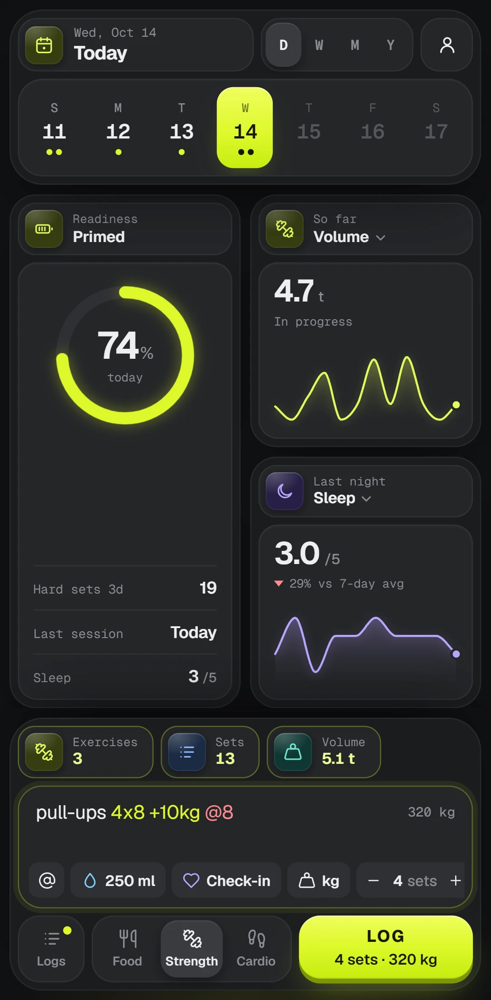

# LogOut

A food and fitness log you type into. Pick Food, Strength or Cardio, write what you had or did the way you'd say
it, and LogOut reads it as you type.

```
chicken breast 200g 330kcal 62p 0c 7f
bench press 3x8 60kg @8
easy run 8km 46:30
```

<p align="center"></p>

- **Text is the record.** Only what you type is kept, and it's never rewritten. Totals, charts and streaks are all
  worked out from it.
- **No forms, no questions.** Colour shows how each part of a line was read. Common foods come with their values
  (USDA, INDB and IFCT tables); anything else takes kcal and macros once and remembers them.
- **Private by default.** Everything is read on the device and works offline. An account only adds sync between
  devices.

Free, at [logout.fit](https://logout.fit). It installs from the browser as an app on phones and computers.

## Repository

| Path              | What it is                                                             |
| ----------------- | ---------------------------------------------------------------------- |
| `apps/web`        | The website and the app at `/app` (SvelteKit, an offline-first PWA).   |
| `packages/engine` | Reads typed lines and works out what they add up to. Plain TypeScript. |
| `packages/sample` | A generated sample history, used by the demo at `/demo` and by tests.  |
| `supabase`        | Database schema, auth settings and the sign-in email for sync.         |
| `docs`            | Images for this README.                                                |

## Development

Requires Node 22.17+ (see `.nvmrc`) and pnpm 11.

```sh
pnpm install
pnpm dev      # http://localhost:5173/app
pnpm test     # unit tests for every package
pnpm check    # type checks
pnpm lint     # eslint + prettier
pnpm --filter @logout/web test:e2e   # browser tests against the production build
```

Browser tests use Playwright's Chromium (`npx playwright install chromium` once), or any Chromium-based browser
given as `CHROME_PATH`.

### Configuration

Every setting is optional. Without any, the app keeps everything on the device and sends nothing anywhere. Copy
`apps/web/.env.example` to `apps/web/.env` and fill in what you use:

- **Sync:** `SUPABASE_URL` and `SUPABASE_KEY` for a Supabase project. Set it up with
  ```sh
  pnpm exec supabase link --project-ref <ref>
  pnpm exec supabase db push
  RESEND_API_KEY=... pnpm exec supabase config push   # auth settings; sign-in codes are emailed through Resend
  ```
- **Error reports:** `SENTRY_DSN` (plus `SENTRY_AUTH_TOKEN`, `SENTRY_ORG`, `SENTRY_PROJECT` to upload source maps).
- **Analytics:** `POSTHOG_KEY`. Only named events with kinds and counts are sent, never what was typed.

### Deploying

The site is hosted on Cloudflare (`apps/web/wrangler.jsonc`).

```sh
pnpm exec wrangler login   # once, from apps/web
pnpm run deploy            # build and upload
```

The landing page screenshots and the one above come from `apps/web/scripts/shots.js`.
